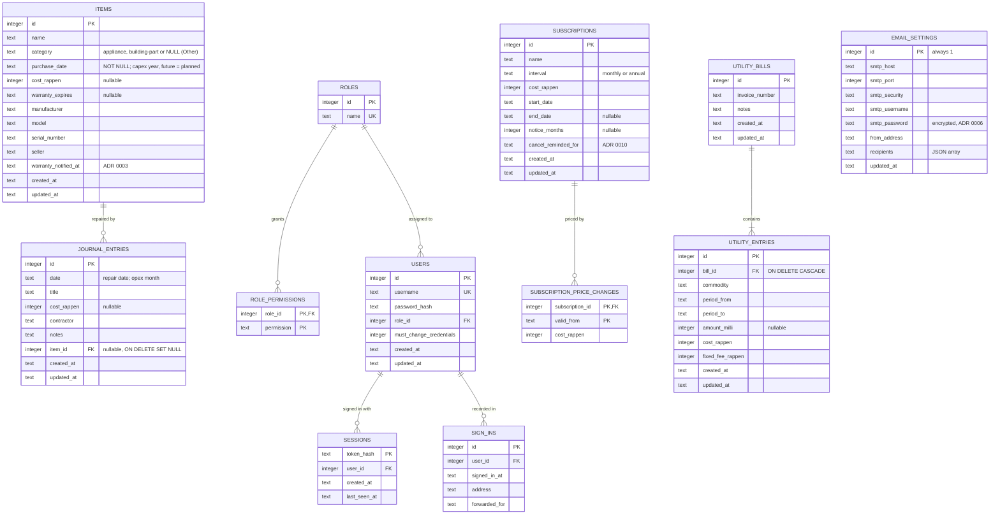

# Data model

The SQLite schema after migration 8 (`Domusmea/src/server/db.ts`). Money is integer Rappen,
calendar dates `YYYY-MM-DD` and timestamps ISO 8601 UTC, all stored as `TEXT` or `INTEGER` (ADR
0004). Capex is derived from `items.purchase_date` and `items.cost_rappen`; no totals are stored.

Indexes: `items_warranty_pending`, `journal_entries_date`, `journal_entries_item`, `sessions_user`,
`sign_ins_user`, `utility_entries_commodity`, `utility_entries_bill`.
